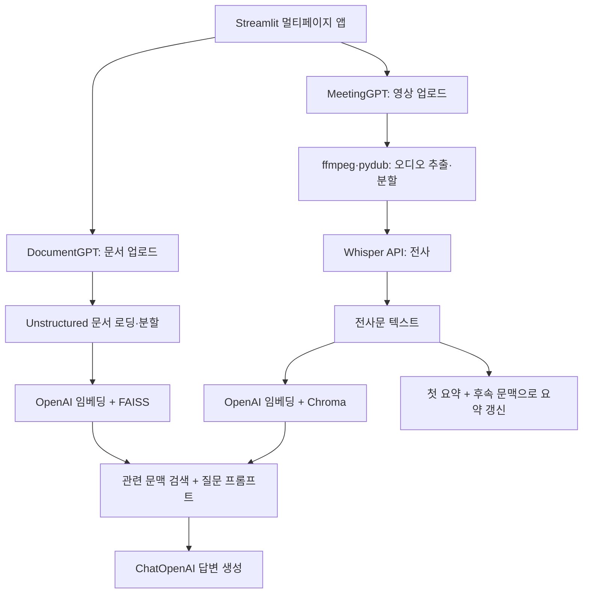

# LangChain 기반 문서·회의 분석

**문서와 회의 영상을 검색 가능한 지식으로 바꾸는 Streamlit·LangChain 프로토타입입니다.**

`DocumentGPT`는 업로드한 문서에서 질문과 관련된 내용을 검색해 답변을 생성합니다. `MeetingGPT`는 영상의 음성을 전사하고, 긴 회의 내용을 순차적으로 요약한 뒤 전사문에 대한 검색·질의응답 체인을 구성합니다.

단순히 LLM에 파일 전체를 전달하는 대신, **텍스트 분할 → 임베딩 → 벡터 검색 → 관련 문맥을 이용한 답변 생성** 과정을 구현하며 RAG와 긴 문서 처리 흐름을 학습한 프로젝트입니다.

[문서 분석 소스](pages/DocumentGPT.py) · [회의 분석 소스](pages/MeetingGPT.py) · [실행 안내](#실행-안내)

## 프로젝트 구성

| 앱 | 입력 | 처리 내용 | 결과 |
| --- | --- | --- | --- |
| DocumentGPT | PDF·TXT·DOCX | 문서 분할, 임베딩 캐시, FAISS 검색, 문맥 기반 답변 | 스트리밍 답변과 화면 대화 이력 |
| MeetingGPT | 회의 영상 | 오디오 추출·분할, Whisper 전사, 점진적 요약, Chroma 검색 | 전사문·요약과 Q&A 체인 |

이 저장소는 로컬 프로젝트의 `main.py`와 `pages/` 앱 소스를 중심으로 정리했습니다. 환경 변수 파일, API 키, 사용자 업로드, 캐시와 노트북 실행 결과는 포함하지 않습니다.

## 시스템 구조



두 앱은 검색에 사용할 문맥을 만드는 방법이 다릅니다. 문서 분석은 파일에서 바로 텍스트를 읽고, 회의 분석은 영상에서 오디오를 추출해 전사문을 만든 다음 같은 RAG 흐름으로 연결합니다.

## DocumentGPT: 문서 기반 질의응답

### 처리 과정

1. 사용자가 PDF·TXT·DOCX 파일을 업로드합니다.
2. `UnstructuredFileLoader`로 문서를 읽고 `CharacterTextSplitter`로 나눕니다.
3. `OpenAIEmbeddings`로 각 조각의 벡터를 생성합니다.
4. `CacheBackedEmbeddings`와 `LocalFileStore`로 임베딩 결과를 재사용합니다.
5. `FAISS`에서 사용자 질문과 관련된 문서 조각을 검색합니다.
6. 검색된 문맥과 질문을 프롬프트에 연결해 답변을 생성합니다.
7. 콜백으로 생성 토큰을 화면에 표시하고 대화 내용을 세션에 저장합니다.

| 설정 | 값 |
| --- | --- |
| 분할 방식 | `CharacterTextSplitter.from_tiktoken_encoder` |
| `chunk_size` | 600 |
| `chunk_overlap` | 100 |
| 벡터 검색 | FAISS retriever |
| LLM 설정 | `temperature=0.1`, 스트리밍 사용 |

프롬프트는 검색된 문맥만 사용하고, 근거가 없으면 모른다고 답하도록 지시합니다. 이는 답변을 문서 범위로 유도하는 설계이며, 정확도를 보장하는 평가 결과를 뜻하지는 않습니다.

### 체인 구성

```text
질문
  ├─ retriever → 문서 조각 → format_docs → context
  └─ RunnablePassthrough → question
       ↓
ChatPromptTemplate → ChatOpenAI → 스트리밍 콜백
```

`st.session_state["messages"]`는 `{message, role}` 목록을 보관해 이전 대화를 화면에 다시 그립니다. 현재 체인은 질문과 검색 문맥을 입력으로 사용하며, 화면 대화 이력 전체를 LLM 프롬프트에 주입하는 구조는 아닙니다.

구현: [pages/DocumentGPT.py](pages/DocumentGPT.py)

## MeetingGPT: 회의 전사·요약·검색

### 영상에서 텍스트까지

```text
회의 영상
  → ffmpeg로 오디오 추출
  → pydub로 10분 단위 오디오 분할
  → Whisper API(whisper-1)로 구간별 전사
  → 전사문 파일 저장
  → Transcript / Summary / Q&A 탭
```

긴 녹음을 여러 구간으로 나누어 전사 요청을 수행하고, 생성한 텍스트를 요약과 검색의 공통 입력으로 사용합니다.

### 긴 전사문의 점진적 요약

전사문은 `RecursiveCharacterTextSplitter`로 나누며 `chunk_size=800`, `chunk_overlap=100`을 사용합니다.

1. 첫 번째 문서 조각으로 초기 요약을 생성합니다.
2. 다음 조각과 기존 요약을 함께 프롬프트에 전달합니다.
3. 새로운 문맥이 유용하면 요약을 갱신하고, 그렇지 않으면 기존 내용을 유지하도록 요청합니다.
4. 이 과정을 순서대로 반복하고 최종 요약을 파일에 저장합니다.

```text
첫 조각 → 초기 요약
초기 요약 + 다음 조각 → 갱신된 요약
갱신된 요약 + 다음 조각 → 최종 요약
```

이는 조각별 결과를 독립적으로 나열하는 방식 대신, **기존 요약을 다음 단계의 입력으로 전달하는 refine 방식**입니다.

### 전사문 검색

전사문을 임베딩한 뒤 `Chroma.from_documents`로 검색 저장소를 구성합니다. 검색된 텍스트를 질문과 함께 프롬프트에 넣는 Q&A 체인이 있으며, 현재 원본의 Q&A 화면은 반환 답변을 표시하는 부분에 보완이 필요합니다.

구현: [pages/MeetingGPT.py](pages/MeetingGPT.py)

## 사용 기술과 저장소

| 기술 | 실제 사용 범위 |
| --- | --- |
| Python·Streamlit | 멀티페이지 UI, 파일 업로드, 채팅·탭·상태 표시 |
| LangChain | 로더·분할기·retriever·프롬프트·LLM 체인 연결 |
| ChatOpenAI | 문맥 기반 답변과 회의 요약 생성 |
| OpenAIEmbeddings | 문서·전사문을 검색용 벡터로 변환 |
| Whisper API | 오디오 구간 전사 |
| FAISS | DocumentGPT의 로컬 벡터 검색 인덱스 |
| Chroma | MeetingGPT의 전사문 벡터 검색 |
| LocalFileStore | 임베딩 바이트 캐시 저장 |
| ffmpeg·pydub | 영상에서 오디오 추출 및 구간 분할 |
| tiktoken | 토큰 길이를 고려한 텍스트 분할 |

FAISS·Chroma는 검색을 담당하고, `LocalFileStore`는 임베딩 결과를 캐시합니다. 현재 코드에는 벡터 저장소의 별도 영구 저장 경로가 지정되어 있지 않으므로, 캐시 파일과 벡터 인덱스 영구 저장을 구분합니다.

`requirements.txt`에는 당시 학습 환경의 전체 의존성이 들어 있습니다. 목록에 있는 Redis·Pinecone·Elasticsearch 등을 이 두 앱이 실제 사용하는 외부 저장소로 소개하지는 않습니다.

## 데이터 구조

실행 중 생성하는 로컬 데이터의 구성입니다. 이 데이터는 Git에서 제외합니다.

```text
.cache/
├── files/                  # DocumentGPT가 업로드 문서를 저장
├── embeddings/             # LocalFileStore 임베딩 캐시
├── chunks/                 # 분할한 오디오
├── <회의영상>.mp4          # 회의 영상 입력
├── <회의영상>.mp3          # 추출한 오디오
├── <회의영상>.txt          # 전사문
└── summary/
    └── <회의영상>.txt      # 최종 요약
```

UI의 대화 이력은 Streamlit 세션에, 전사문·요약·임베딩 캐시는 로컬 파일에 보관합니다. 별도 사용자 계정 데이터베이스를 갖춘 서비스보다는 로컬 분석 프로토타입에 해당합니다.

## 프로젝트 구조

```text
langchain_2023/
├── main.py                 # Streamlit 시작 화면
├── pages/
│   ├── DocumentGPT.py      # 문서 업로드·FAISS 검색·채팅
│   └── MeetingGPT.py       # 영상 전사·refine 요약·Chroma 검색
├── .streamlit/
│   └── config.toml         # 원본 Streamlit 서버 설정
├── requirements.txt        # 기존 학습 환경 의존성
├── .gitignore
└── README.md
```

## 구현에서 다룬 내용

- **RAG 흐름 구성:** 질문에 필요한 문서 조각을 검색해 프롬프트 문맥으로 전달했습니다.
- **분할 방식 비교:** 문서는 600/100, 회의 전사문은 800/100 설정으로 각 처리 흐름을 구성했습니다. 최적값으로 평가한 수치는 아닙니다.
- **캐시와 UI 상태 분리:** 임베딩은 파일 캐시에, 대화는 Streamlit 세션에 저장하도록 나눴습니다.
- **멀티모달 입력의 텍스트화:** 영상·오디오를 전사문으로 바꾼 뒤 문서 분석과 같은 검색 과정으로 연결했습니다.
- **긴 문서 요약:** 기존 요약과 새 문맥을 순서대로 결합하는 체인을 구성했습니다.

## 실행 안내

이 저장소는 기존 소스와 의존성을 보존한 학습 프로젝트입니다. 원본 목록은 `langchain==0.0.332`, `openai==0.28.0`, `streamlit==1.27.2`를 포함하며, 일부 소스는 이후 분리된 패키지 경로를 사용해 실행 전 버전·import 경로 조정이 필요합니다.

기본 실행 형태는 다음과 같습니다. OpenAI 키는 코드에 넣지 않고 환경 변수로 전달합니다.

```bash
git clone https://github.com/kennyHyunSeokCho/langchain_2023.git
cd langchain_2023
python3 -m venv .venv
source .venv/bin/activate
python -m pip install -r requirements.txt
export OPENAI_API_KEY="YOUR_OPENAI_API_KEY"
mkdir -p .cache/files .cache/embeddings .cache/chunks .cache/summary
streamlit run main.py
```

### 실행 전 확인할 부분

- DocumentGPT의 `langchain_community` import와 MeetingGPT의 사용하지 않는 `langchain_core.memory` import를 원본 의존성 버전과 맞춰야 합니다.
- MeetingGPT의 ffmpeg 경로는 `/opt/homebrew/bin/ffmpeg`로 고정되어 있습니다. 실행 환경에 맞게 조정해야 하며, 파일명 변환은 현재 MP4 기준입니다.
- 전사·오디오 캐시는 파일별 분리, 처리 순서와 중복 실행 대응을 보완할 수 있습니다.
- MeetingGPT의 Q&A 체인 반환값 표시와 DocumentGPT 스트리밍 메시지 초기화는 후속 개선 대상입니다.

이번 정리에서는 소스 구문과 업로드 범위를 확인했으며, OpenAI API를 호출하는 전사·생성 통합 실행은 수행하지 않았습니다.
